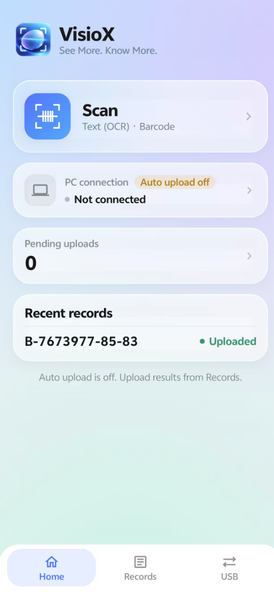
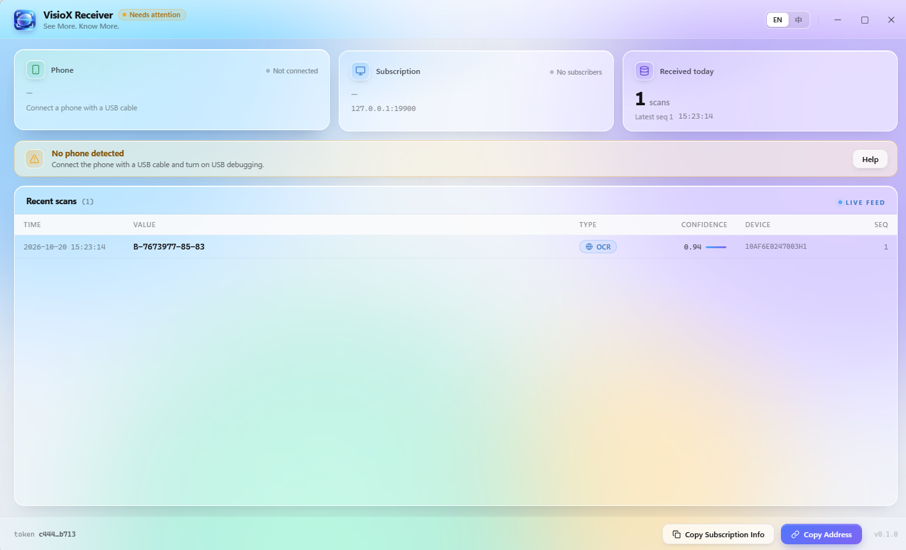
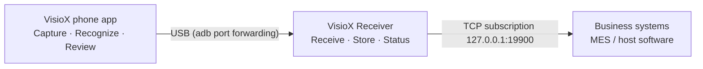

<div align="center">


# VisioX

**See More. Know More.**

Recognize text and barcodes with a phone camera, review the result, and deliver it over USB to your PC and business systems in real time.


[简体中文](README.md) · English

</div>

---

## Contents

- [Screenshots](#screenshots)
- [Highlights](#highlights)
- [How it works](#how-it-works)
- [Features](#features)
- [Getting started](#getting-started)
- [Integration](#integration)
- [FAQ](#faq)

## Screenshots

<table>
  <tr>
    <td align="center" width="30%"></td>
    <td align="center" width="70%"></td>
  </tr>
  <tr>
    <td align="center"><sub>VisioX phone app: scan entry, PC connection, pending uploads and recent records</sub></td>
    <td align="center"><sub>VisioX Receiver: phone, subscription and daily status with a live record feed</sub></td>
  </tr>
</table>

## Highlights

| | Highlight | Description |
|---|---|---|
| **EASY** | Ready to use | No account needed. Recognition runs on the phone. Connect over USB and start. |
| **OPEN** | Open interface | A TCP subscription interface lets MES and host software connect in Java, Qt, C# and other languages. |
| **FIT** | Multi-device | Runs on industrial PDAs and phones with Android 14 or later. Reads text, barcodes and QR codes. |

## How it works



1. **Connect**: start the receiver, connect the phone over USB and allow debugging.
2. **Capture**: choose text or barcode mode and photograph the target.
3. **Review**: check the result; edit or retake if needed.
4. **Deliver**: after submission the result reaches the PC; the phone shows delivery status.

Capture also works without a connection: records are kept on the phone and sent automatically when the connection returns, or uploaded manually.

## Features

### Phone app · VisioX (Android)

- **Recognize**: text (OCR), 1D barcodes and QR codes, on the device.
- **Review**: shows the raw value and an editable confirmed value; low-confidence characters are shown in red; submit after confirming.
- **Records**: track delivery status; upload automatically or manually.
- **Hardware shutter**: the PDA scan key, camera key or volume keys can take the photo.

### Desktop receiver · VisioX Receiver (Windows)

- **Status**: shows phone connection and service status in real time.
- **Storage**: saves results and lists recent records.
- **Subscription**: business systems receive results in real time and resume from the last position after reconnecting.
- **Tray mode**: keeps receiving in the background after the window is closed.
- **Chinese / English UI**: switch with one click.

## Getting started

**Requirements**

| Side | Requirement |
|---|---|
| Phone | Android 14 or later, 64-bit ARM (industrial PDA or phone) |
| PC | Windows 10 / 11 x64 |

**Steps**

1. Install VisioX Receiver on the PC (the installer includes adb and the WebView2 bootstrapper). It runs in the system tray.
2. Install VisioX on the phone and allow camera access on first launch.
3. On the phone, turn on **Developer options → USB debugging**, connect it to the PC with a cable and allow debugging.
4. When the home screen shows **PC connected**, tap **Scan**.

> Keep the phone app in the foreground while scanning.

## Integration

The receiver provides a TCP subscription interface at `127.0.0.1:19900`. Each message is one line of UTF-8 JSON ending with `\n`.

```text
client → {"type":"SUBSCRIBE","clientId":"my-subscriber","fromSeq":0,"scanTypes":[],"token":"..."}
server → {"type":"SUBSCRIBED","protocolVersion":1,"lastSeq":457,"fromSeq":456,...}
server → {"type":"SCAN_EVENT","id":457,"value":"AB12-3456","createdAt":"2026-10-20T09:15:02.318+08:00","requestId":"..."}
client → {"type":"ACK","seq":457}
server → {"type":"HEARTBEAT","lastSeq":457}          // every 10 s
```

| Setting | Default | Description |
|---|---|---|
| Address | `127.0.0.1:19900` | Must match the port in Receiver Settings → Subscription |
| token | — | Copy the subscription token from Receiver settings. Do not commit a production token to version control. |
| clientId | `my-subscriber` | The receiver stores the ACK position per clientId and resumes from it. Use a different clientId for each program. |
| fromSeq | `0` | 0 = resume from the last ACK (full history on first run); -1 = new events only; n = replay events after seq n |
| scanTypes | `[]` | Empty array = all types (text `WAFER_OCR` and barcode `BARCODE`) |

| SCAN_EVENT field | Description |
|---|---|
| `id` | Event sequence number (= seq), increasing. Send it back as `seq` in the ACK. Make database writes idempotent by id. |
| `value` | Value confirmed by the operator (use this value) |
| `createdAt` | Time the receiver stored the event (RFC 3339) |
| `requestId` | Request ID generated by the phone, for tracing |

> Always send ACK. The receiver tracks the position of each clientId by ACK. Events without an ACK are sent again after reconnecting (at-least-once delivery).

### Sample code

The samples only subscribe, read, print and ACK. They exit on `ERROR` or disconnect. For production, add reconnect with 2–10 s backoff using the same clientId, deduplicate by `id`, and treat 30 s without data (3 missed heartbeats) as a disconnect.

<details open>
<summary><b>Java</b> (JDK 11+, no third-party dependencies)</summary>

```java
import java.io.BufferedReader;
import java.io.InputStreamReader;
import java.io.OutputStream;
import java.net.Socket;
import java.nio.charset.StandardCharsets;
import java.time.LocalDateTime;
import java.time.format.DateTimeFormatter;
import java.util.regex.Matcher;
import java.util.regex.Pattern;

public class Subscriber {
    static final String HOST = "127.0.0.1";
    static final int PORT = 19900;
    static final String TOKEN = "<YOUR_TOKEN>";
    static final String CLIENT_ID = "my-subscriber";
    static final DateTimeFormatter TIME = DateTimeFormatter.ofPattern("yyyy-MM-dd HH:mm:ss.SSS");

    static final Pattern TYPE = Pattern.compile("\"type\"\\s*:\\s*\"(\\w+)\"");
    static final Pattern ID = Pattern.compile("\"id\"\\s*:\\s*(\\d+)");

    public static void main(String[] args) throws Exception {
        try (Socket socket = new Socket(HOST, PORT)) {
            BufferedReader in = new BufferedReader(
                    new InputStreamReader(socket.getInputStream(), StandardCharsets.UTF_8));
            OutputStream out = socket.getOutputStream();

            send(out, "{\"type\":\"SUBSCRIBE\",\"clientId\":\"" + CLIENT_ID
                    + "\",\"fromSeq\":0,\"scanTypes\":[],\"token\":\"" + TOKEN + "\"}");
            log("connected " + HOST + ":" + PORT);

            String line;
            while ((line = in.readLine()) != null) {
                if (line.isBlank()) continue;
                log(line);
                String type = find(TYPE, line);
                if ("SCAN_EVENT".equals(type)) {
                    // Handle the event here (e.g. write to MES / DB, idempotent by id), then ACK
                    send(out, "{\"type\":\"ACK\",\"seq\":" + find(ID, line) + "}");
                } else if ("ERROR".equals(type)) {
                    break;
                }
            }
            log("connection closed");
        }
    }

    static void send(OutputStream out, String json) throws Exception {
        out.write((json + "\n").getBytes(StandardCharsets.UTF_8));
        out.flush();
    }

    static String find(Pattern p, String line) {
        Matcher m = p.matcher(line);
        return m.find() ? m.group(1) : null;
    }

    static void log(String s) {
        System.out.println(LocalDateTime.now().format(TIME) + "  " + s);
    }
}
```

```powershell
java -Dfile.encoding=UTF-8 Subscriber.java
```

</details>

<details>
<summary><b>Qt 6</b> (Core + Network, CMake 3.16+)</summary>

```cmake
cmake_minimum_required(VERSION 3.16)
project(Subscriber LANGUAGES CXX)
set(CMAKE_CXX_STANDARD 17)
find_package(Qt6 REQUIRED COMPONENTS Core Network)
add_executable(Subscriber main.cpp)
target_link_libraries(Subscriber PRIVATE Qt6::Core Qt6::Network)
```

```cpp
#include <QCoreApplication>
#include <QDateTime>
#include <QJsonArray>
#include <QJsonDocument>
#include <QJsonObject>
#include <QTcpSocket>
#include <cstdio>

static const char *HOST = "127.0.0.1";
static const quint16 PORT = 19900;
static const char *TOKEN = "<YOUR_TOKEN>";
static const char *CLIENT_ID = "my-subscriber";

static void logLine(const QString &s)
{
    std::printf("%s  %s\n",
                qUtf8Printable(QDateTime::currentDateTime().toString("yyyy-MM-dd HH:mm:ss.zzz")),
                qUtf8Printable(s));
    std::fflush(stdout);
}

static void send(QTcpSocket &socket, const QJsonObject &obj)
{
    socket.write(QJsonDocument(obj).toJson(QJsonDocument::Compact) + '\n');
}

int main(int argc, char *argv[])
{
    QCoreApplication app(argc, argv);
    QTcpSocket socket;

    QObject::connect(&socket, &QTcpSocket::connected, [&] {
        send(socket, QJsonObject{{"type", "SUBSCRIBE"}, {"clientId", CLIENT_ID},
                                 {"fromSeq", 0}, {"scanTypes", QJsonArray()}, {"token", TOKEN}});
        logLine(QString("connected %1:%2").arg(HOST).arg(PORT));
    });

    QObject::connect(&socket, &QTcpSocket::readyRead, [&] {
        while (socket.canReadLine()) {
            const QByteArray line = socket.readLine().trimmed();
            if (line.isEmpty()) continue;
            logLine(QString::fromUtf8(line));
            const QJsonObject msg = QJsonDocument::fromJson(line).object();
            const QString type = msg.value("type").toString();
            if (type == "SCAN_EVENT") {
                // Handle the event here (e.g. write to MES / DB, idempotent by id), then ACK
                send(socket, QJsonObject{{"type", "ACK"}, {"seq", msg.value("id").toInteger()}});
            } else if (type == "ERROR") {
                socket.disconnectFromHost();
            }
        }
    });

    QObject::connect(&socket, &QTcpSocket::disconnected, [&] {
        logLine("connection closed");
        app.quit();
    });
    QObject::connect(&socket, &QTcpSocket::errorOccurred, [&](QAbstractSocket::SocketError) {
        logLine("error: " + socket.errorString());
        app.exit(1);
    });

    socket.connectToHost(HOST, PORT);
    return app.exec();
}
```

```powershell
cmake -B build -DCMAKE_PREFIX_PATH=C:\Qt\6.8.0\msvc2022_64
cmake --build build --config Release
.\build\Release\Subscriber.exe
```

</details>

<details>
<summary><b>C#</b> (.NET 8, no third-party packages)</summary>

```csharp
using System.Net.Sockets;
using System.Text;
using System.Text.Json;

const string Host = "127.0.0.1";
const int Port = 19900;
const string Token = "<YOUR_TOKEN>";
const string ClientId = "my-subscriber";

Console.OutputEncoding = Encoding.UTF8;

using var client = new TcpClient();
await client.ConnectAsync(Host, Port);
using var stream = client.GetStream();
using var reader = new StreamReader(stream, new UTF8Encoding(false));
using var writer = new StreamWriter(stream, new UTF8Encoding(false)) { NewLine = "\n", AutoFlush = true };

await writer.WriteLineAsync(JsonSerializer.Serialize(new
{
    type = "SUBSCRIBE", clientId = ClientId, fromSeq = 0,
    scanTypes = Array.Empty<string>(), token = Token
}));
Log($"connected {Host}:{Port}");

string? line;
while ((line = await reader.ReadLineAsync()) != null)
{
    if (string.IsNullOrWhiteSpace(line)) continue;
    Log(line);
    using var doc = JsonDocument.Parse(line);
    var type = doc.RootElement.TryGetProperty("type", out var t) ? t.GetString() : null;
    if (type == "SCAN_EVENT")
    {
        // Handle the event here (e.g. write to MES / DB, idempotent by id), then ACK
        var id = doc.RootElement.GetProperty("id").GetInt64();
        await writer.WriteLineAsync($"{{\"type\":\"ACK\",\"seq\":{id}}}");
    }
    else if (type == "ERROR")
    {
        break;
    }
}
Log("connection closed");

static void Log(string s) => Console.WriteLine($"{DateTime.Now:yyyy-MM-dd HH:mm:ss.fff}  {s}");
```

```powershell
dotnet new console -n Subscriber
cd Subscriber
# after replacing Program.cs
dotnet run
```

</details>

**Sample output**

```text
2026-10-20 09:14:58.102  connected 127.0.0.1:19900
2026-10-20 09:14:58.115  {"type":"SUBSCRIBED","protocolVersion":1,"lastSeq":456,"fromSeq":456,...}
2026-10-20 09:15:02.320  {"type":"SCAN_EVENT","id":457,"value":"AB12-3456","createdAt":"2026-10-20T09:15:02.318+08:00","requestId":"..."}
2026-10-20 09:15:08.116  {"type":"HEARTBEAT","lastSeq":457}
```

## FAQ

<details>
<summary><b>The phone keeps showing "Not connected"</b></summary>

Check that USB debugging is on and allowed for this PC, VisioX Receiver is running, and the phone app is in the foreground.
</details>

<details>
<summary><b>The subscriber gets Connection refused</b></summary>

The receiver is not running, or the subscription port is not 19900. Start VisioX Receiver and check the port in Settings → Subscription.
</details>

<details>
<summary><b>The subscriber gets ERROR UNAUTHORIZED</b></summary>

Token mismatch. Copy the token from Receiver settings into the code constant.
</details>

<details>
<summary><b>The same event arrives twice</b></summary>

The connection dropped before the ACK was sent. This is normal for at-least-once delivery. Handle events idempotently by `id`.
</details>

<details>
<summary><b>Subscribers overwrite each other's position</b></summary>

They share one clientId. Give each subscriber its own clientId.
</details>

---

<div align="center"><sub>VisioX · See More. Know More.</sub></div>
