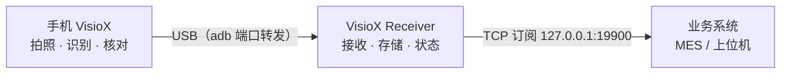

<div align="center">


# VisioX

**See More. Know More.**

手机拍照识别文字与条码，人工核对后通过 USB 实时送达电脑和业务系统。


简体中文 · [English](README.en.md)

</div>

---

## 目录

- [界面预览](#界面预览)
- [产品特点](#产品特点)
- [工作方式](#工作方式)
- [功能](#功能)
- [快速开始](#快速开始)
- [系统对接](#系统对接)
- [常见问题](#常见问题)

## 界面预览

<table>
  <tr>
    <td align="center" width="30%"></td>
    <td align="center" width="70%"></td>
  </tr>
  <tr>
    <td align="center"><sub>手机端 VisioX：扫码入口、PC 连接状态、待上报与最近记录</sub></td>
    <td align="center"><sub>桌面接收端 VisioX Receiver：手机 / 订阅 / 今日接收状态与实时记录</sub></td>
  </tr>
</table>

## 产品特点

| | 特点 | 说明 |
|---|---|---|
| **EASY** | 开箱即用 | 无需账号，识别在手机本地完成；USB 连接后即可使用。 |
| **OPEN** | 开放接口 | 提供 TCP 订阅接口，MES 与上位机可用 Java、Qt、C# 等语言接入。 |
| **FIT** | 多设备适配 | 支持 Android 14 及以上的工业 PDA 与手机，可识别文字、条码和二维码。 |

## 工作方式



1. **连接**：启动接收端，用 USB 连接手机并允许调试。
2. **拍照**：选择文字或条码模式，对准目标拍照。
3. **核对**：核对识别结果，可修改或重拍。
4. **送达**：提交后结果实时送达电脑，手机可查看送达状态。

未连接时也可采集：记录先保存在手机，恢复连接后自动补发，也可手动上报。

## 功能

### 手机端 · VisioX（Android）

- **拍照识别**：文字（OCR）、一维码与二维码，在手机本地识别。
- **人工核对**：显示识别原值与可编辑的确认值，低置信字符标红，确认后提交。
- **记录管理**：查看送达状态，支持自动或手动上报。
- **硬件快门**：PDA 扫码键、相机键或音量键可作快门。

### 桌面接收端 · VisioX Receiver（Windows）

- **连接状态**：实时显示手机连接与服务状态。
- **接收存储**：保存识别结果，查看最近记录。
- **订阅接口**：业务系统实时获取结果，重连后从断点续传。
- **托盘运行**：关闭窗口后在后台持续接收。
- **中英文界面**：一键切换。

## 快速开始

**环境要求**

| 端 | 要求 |
|---|---|
| 手机 | Android 14 及以上，64 位 ARM（工业 PDA 或手机） |
| 电脑 | Windows 10 / 11 x64 |

**步骤**

1. 在电脑上安装 VisioX Receiver（安装包已内置 adb 与 WebView2 引导程序），启动后常驻托盘。
2. 在手机上安装 VisioX，首次打开允许相机权限。
3. 手机开启 **开发者选项 → USB 调试**，用数据线连接电脑并允许调试。
4. 手机首页显示 **PC 已连接** 后，点 **Scan** 开始识别。

> 使用时保持手机 App 在前台。

## 系统对接

接收端在本机 `127.0.0.1:19900` 提供 TCP 订阅接口。每条消息是一行 UTF-8 JSON，以 `\n` 结尾。

```text
客户端 → {"type":"SUBSCRIBE","clientId":"my-subscriber","fromSeq":0,"scanTypes":[],"token":"..."}
服务端 → {"type":"SUBSCRIBED","protocolVersion":1,"lastSeq":457,"fromSeq":456,...}
服务端 → {"type":"SCAN_EVENT","id":457,"value":"AB12-3456","createdAt":"2026-10-20T09:15:02.318+08:00","requestId":"..."}
客户端 → {"type":"ACK","seq":457}
服务端 → {"type":"HEARTBEAT","lastSeq":457}          // 每 10 秒
```

| 配置 | 默认值 | 说明 |
|---|---|---|
| 地址 | `127.0.0.1:19900` | 与接收端“设置 → 订阅”中的端口一致 |
| token | — | 复制接收端设置页中的订阅 token；不要把生产 token 提交到版本库 |
| clientId | `my-subscriber` | 接收端按 clientId 记录已 ACK 位置，下次从该位置续传；不同程序用不同 clientId |
| fromSeq | `0` | 0 = 从已 ACK 位置续传（首次为全部历史）；-1 = 只收新消息；n = 从 seq n 之后重放 |
| scanTypes | `[]` | 空数组 = 全部（文字 `WAFER_OCR` 与条码 `BARCODE`） |

| SCAN_EVENT 字段 | 说明 |
|---|---|
| `id` | 事件序号（= seq），递增；ACK 时回传为 `seq`；业务写库建议按 id 幂等 |
| `value` | 人工确认后的识别值（业务以此为准） |
| `createdAt` | 接收端落盘时间（RFC 3339） |
| `requestId` | 手机端生成的请求 ID，可用于追溯 |

> ACK 不能省略：接收端以 ACK 记录 clientId 的消费位置，未 ACK 的事件在重连后会再次推送（至少一次投递）。

### 示例代码

以下示例只做“订阅、读取、打印、ACK”，收到 `ERROR` 或连接断开即退出。正式接入时建议补充：断线重连（退避 2–10 秒，用同一 clientId 续传）、按 `id` 去重、30 秒无数据（3 次心跳）判定断线。

<details open>
<summary><b>Java</b>（JDK 11+，无第三方依赖）</summary>

```java
import java.io.BufferedReader;
import java.io.InputStreamReader;
import java.io.OutputStream;
import java.net.Socket;
import java.nio.charset.StandardCharsets;
import java.time.LocalDateTime;
import java.time.format.DateTimeFormatter;
import java.util.regex.Matcher;
import java.util.regex.Pattern;

public class Subscriber {
    static final String HOST = "127.0.0.1";
    static final int PORT = 19900;
    static final String TOKEN = "<YOUR_TOKEN>";
    static final String CLIENT_ID = "my-subscriber";
    static final DateTimeFormatter TIME = DateTimeFormatter.ofPattern("yyyy-MM-dd HH:mm:ss.SSS");

    static final Pattern TYPE = Pattern.compile("\"type\"\\s*:\\s*\"(\\w+)\"");
    static final Pattern ID = Pattern.compile("\"id\"\\s*:\\s*(\\d+)");

    public static void main(String[] args) throws Exception {
        try (Socket socket = new Socket(HOST, PORT)) {
            BufferedReader in = new BufferedReader(
                    new InputStreamReader(socket.getInputStream(), StandardCharsets.UTF_8));
            OutputStream out = socket.getOutputStream();

            send(out, "{\"type\":\"SUBSCRIBE\",\"clientId\":\"" + CLIENT_ID
                    + "\",\"fromSeq\":0,\"scanTypes\":[],\"token\":\"" + TOKEN + "\"}");
            log("connected " + HOST + ":" + PORT);

            String line;
            while ((line = in.readLine()) != null) {
                if (line.isBlank()) continue;
                log(line);
                String type = find(TYPE, line);
                if ("SCAN_EVENT".equals(type)) {
                    // Handle the event here (e.g. write to MES / DB, idempotent by id), then ACK
                    send(out, "{\"type\":\"ACK\",\"seq\":" + find(ID, line) + "}");
                } else if ("ERROR".equals(type)) {
                    break;
                }
            }
            log("connection closed");
        }
    }

    static void send(OutputStream out, String json) throws Exception {
        out.write((json + "\n").getBytes(StandardCharsets.UTF_8));
        out.flush();
    }

    static String find(Pattern p, String line) {
        Matcher m = p.matcher(line);
        return m.find() ? m.group(1) : null;
    }

    static void log(String s) {
        System.out.println(LocalDateTime.now().format(TIME) + "  " + s);
    }
}
```

```powershell
java -Dfile.encoding=UTF-8 Subscriber.java
```

</details>

<details>
<summary><b>Qt 6</b>（Core + Network，CMake 3.16+）</summary>

```cmake
cmake_minimum_required(VERSION 3.16)
project(Subscriber LANGUAGES CXX)
set(CMAKE_CXX_STANDARD 17)
find_package(Qt6 REQUIRED COMPONENTS Core Network)
add_executable(Subscriber main.cpp)
target_link_libraries(Subscriber PRIVATE Qt6::Core Qt6::Network)
```

```cpp
#include <QCoreApplication>
#include <QDateTime>
#include <QJsonArray>
#include <QJsonDocument>
#include <QJsonObject>
#include <QTcpSocket>
#include <cstdio>

static const char *HOST = "127.0.0.1";
static const quint16 PORT = 19900;
static const char *TOKEN = "<YOUR_TOKEN>";
static const char *CLIENT_ID = "my-subscriber";

static void logLine(const QString &s)
{
    std::printf("%s  %s\n",
                qUtf8Printable(QDateTime::currentDateTime().toString("yyyy-MM-dd HH:mm:ss.zzz")),
                qUtf8Printable(s));
    std::fflush(stdout);
}

static void send(QTcpSocket &socket, const QJsonObject &obj)
{
    socket.write(QJsonDocument(obj).toJson(QJsonDocument::Compact) + '\n');
}

int main(int argc, char *argv[])
{
    QCoreApplication app(argc, argv);
    QTcpSocket socket;

    QObject::connect(&socket, &QTcpSocket::connected, [&] {
        send(socket, QJsonObject{{"type", "SUBSCRIBE"}, {"clientId", CLIENT_ID},
                                 {"fromSeq", 0}, {"scanTypes", QJsonArray()}, {"token", TOKEN}});
        logLine(QString("connected %1:%2").arg(HOST).arg(PORT));
    });

    QObject::connect(&socket, &QTcpSocket::readyRead, [&] {
        while (socket.canReadLine()) {
            const QByteArray line = socket.readLine().trimmed();
            if (line.isEmpty()) continue;
            logLine(QString::fromUtf8(line));
            const QJsonObject msg = QJsonDocument::fromJson(line).object();
            const QString type = msg.value("type").toString();
            if (type == "SCAN_EVENT") {
                // Handle the event here (e.g. write to MES / DB, idempotent by id), then ACK
                send(socket, QJsonObject{{"type", "ACK"}, {"seq", msg.value("id").toInteger()}});
            } else if (type == "ERROR") {
                socket.disconnectFromHost();
            }
        }
    });

    QObject::connect(&socket, &QTcpSocket::disconnected, [&] {
        logLine("connection closed");
        app.quit();
    });
    QObject::connect(&socket, &QTcpSocket::errorOccurred, [&](QAbstractSocket::SocketError) {
        logLine("error: " + socket.errorString());
        app.exit(1);
    });

    socket.connectToHost(HOST, PORT);
    return app.exec();
}
```

```powershell
cmake -B build -DCMAKE_PREFIX_PATH=C:\Qt\6.8.0\msvc2022_64
cmake --build build --config Release
.\build\Release\Subscriber.exe
```

</details>

<details>
<summary><b>C#</b>（.NET 8，无第三方包）</summary>

```csharp
using System.Net.Sockets;
using System.Text;
using System.Text.Json;

const string Host = "127.0.0.1";
const int Port = 19900;
const string Token = "<YOUR_TOKEN>";
const string ClientId = "my-subscriber";

Console.OutputEncoding = Encoding.UTF8;

using var client = new TcpClient();
await client.ConnectAsync(Host, Port);
using var stream = client.GetStream();
using var reader = new StreamReader(stream, new UTF8Encoding(false));
using var writer = new StreamWriter(stream, new UTF8Encoding(false)) { NewLine = "\n", AutoFlush = true };

await writer.WriteLineAsync(JsonSerializer.Serialize(new
{
    type = "SUBSCRIBE", clientId = ClientId, fromSeq = 0,
    scanTypes = Array.Empty<string>(), token = Token
}));
Log($"connected {Host}:{Port}");

string? line;
while ((line = await reader.ReadLineAsync()) != null)
{
    if (string.IsNullOrWhiteSpace(line)) continue;
    Log(line);
    using var doc = JsonDocument.Parse(line);
    var type = doc.RootElement.TryGetProperty("type", out var t) ? t.GetString() : null;
    if (type == "SCAN_EVENT")
    {
        // Handle the event here (e.g. write to MES / DB, idempotent by id), then ACK
        var id = doc.RootElement.GetProperty("id").GetInt64();
        await writer.WriteLineAsync($"{{\"type\":\"ACK\",\"seq\":{id}}}");
    }
    else if (type == "ERROR")
    {
        break;
    }
}
Log("connection closed");

static void Log(string s) => Console.WriteLine($"{DateTime.Now:yyyy-MM-dd HH:mm:ss.fff}  {s}");
```

```powershell
dotnet new console -n Subscriber
cd Subscriber
# 替换 Program.cs 后
dotnet run
```

</details>

**输出示例**

```text
2026-10-20 09:14:58.102  connected 127.0.0.1:19900
2026-10-20 09:14:58.115  {"type":"SUBSCRIBED","protocolVersion":1,"lastSeq":456,"fromSeq":456,...}
2026-10-20 09:15:02.320  {"type":"SCAN_EVENT","id":457,"value":"AB12-3456","createdAt":"2026-10-20T09:15:02.318+08:00","requestId":"..."}
2026-10-20 09:15:08.116  {"type":"HEARTBEAT","lastSeq":457}
```

## 常见问题

<details>
<summary><b>手机一直显示“未连接”</b></summary>

确认手机已开启 USB 调试并允许当前电脑；电脑上 VisioX Receiver 正在运行；手机 App 处于前台。
</details>

<details>
<summary><b>订阅程序报 Connection refused</b></summary>

接收端未运行，或订阅端口不是 19900。启动 VisioX Receiver，核对“设置 → 订阅”中的端口。
</details>

<details>
<summary><b>订阅程序收到 ERROR UNAUTHORIZED</b></summary>

token 不一致。从接收端设置页复制 token 替换代码常量。
</details>

<details>
<summary><b>同一事件收到两次</b></summary>

上次处理后未及时 ACK 就断开，属于至少一次投递的正常行为。业务按 `id` 幂等处理。
</details>

<details>
<summary><b>多个订阅程序互相影响消费位置</b></summary>

共用了同一个 clientId。每个订阅程序使用独立 clientId。
</details>

---

<div align="center"><sub>VisioX · See More. Know More.</sub></div>
